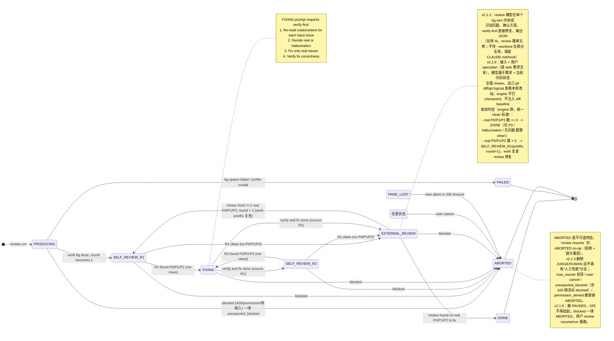
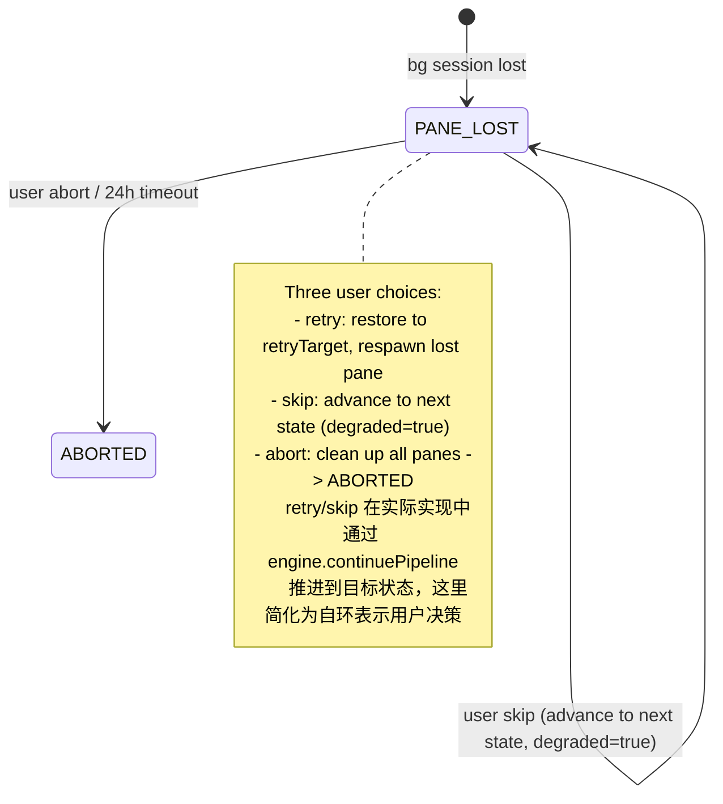

# Review Engine v2.1.1 - 数据流 & 状态机

> 属于 [overview.md](./overview.md) 的下游文件。

## 4. 数据流

### 4.1 一次完整 pipeline 的事件序列

```
时间轴  组件                       动作
─────  ─────────────────         ────────────────────────────────────────────────
T0    用户                        cc-linker review run "帮我修 NPE in auth.ts"
T0.5  CLI                         doctor 验证通过后 **fork 后台 engine 子进程**（写 engine.pid），立即返回 pipelineId；engine 接管后续 T1+ 全部状态机推进 + reconciler 循环。前台 `--watch` 可选 attach
T1    Engine (review doctor)      验证：profile.default 引用 provider + CLI ≥ 2.1.139 + daemon 健康
T2    Engine                      调 phase-detect.detect(...) -> 'code'
T3    Engine                      调 profile.load('default') -> merged profile
T4    Engine                      调 adapter.startSession({ role:'work', provider:'claude-sonnet-4', prompt:'NPE in auth.ts', isNew:true })
T5    Adapter                     Bun.spawn(['claude','--bg','NPE in auth.ts','--settings',sonnetPath])
T6    CLI (Claude)                spawn bg session, 写 ~/.claude/jobs/<short1>/state.json, 返回 shortId
T7    Adapter                     解析 stdout "backgrounded · short1" + 轮询 readJobState 拿 sessionId
T8    Engine                      写 PipelineRecord 到 running/<pipelineId>/pipeline.json
                                  panes.work = { sessionId: '<uuid>', currentRoundShortId: 'short1', startedAt: ... }
T9    CLI (watch mode)            ANSI 进度条更新：state=PRODUCING, panes=[work:busy]
T10   CLI (Claude work bg)        ...处理中...
T11   CLI (Claude work bg)        state.json.state: 'running' -> 'done'
T12   Adapter.poll(short1)        detect state.json.state == 'done' -> emit 'work_produced'
T13   Engine                      transition: PRODUCING -> SELF_REVIEW_R1 (round=1)
T14   Engine                      调 adapter.resumeWorkSession({ sessionId, prompt:'基于需求+当前代码全面自查（identify only）...', provider:'claude-sonnet-4' })
T15   Adapter                     Bun.spawn(['claude','--bg','review...','--resume',sessionId,'--reply-on-resume','--settings',sonnetPath])
T16   CLI (Claude work bg)        新 shortId2，sessionId 不变
T17   Engine                      panes.work.currentRoundShortId = 'short2'
T19   ...                         R1 发现 3 P0/P1/P2 issues（不 clean）
T20   Engine                      transition: SELF_REVIEW_R1 -> FIXING (source=R1)
T21   Engine                      调 adapter.resumeWorkSession({ sessionId, prompt:'verify each issue, fix real ones...' })
T24   Adapter.poll(short2)        FIXING 完成 -> emit 'fix_complete'
T25   Engine                      FIXING(source=R1) -> SELF_REVIEW_R2
T28   ...                         R2 发现 1 new P0/P1/P2 issue -> FIXING(source=R2) -> EXTERNAL_REVIEW
T28b  ...                         （若 R2 clean，同样直接 -> EXTERNAL_REVIEW：v2.1.3 无论如何都跑一轮外审）
T31   Engine                      adapter.startSession({ role:'review', provider:'kimi-for-coding', prompt:'基于需求+当前代码全面 review 并直接修复...' })
T32   Adapter                     spawn 1 个 bg session，shortId5
T33   Engine                      panes.review = {role:'review', shortId:'short5', sessionId:'uuid-r', round:1}
T35   Review bg (kimi)            识别问题 -> 确认方案 -> verify-first 修复 -> 输出 JSON
T36   Adapter.poll(short5)        done -> emit 'external_fix_complete'
T37   Engine                      parse review output：发现并修复了 ≥1 个 real P0/P1/P2 issue -> transition: EXTERNAL_REVIEW -> SELF_REVIEW_R1 (cycle:'postfix', round=2)
                                   （若 review 无 real P0/P1/P2 需修：-> DONE）
T40   Engine                      work postfix R1 全面复查当前代码状态；发现 0 P0/P1/P2 -> R2 -> EXTERNAL_REVIEW -> review 无可修 -> DONE
T47   Engine                      写 PipelineRecord 到 done/，CLI 输出 state=DONE + Markdown 报告路径
```

> **v2.1.6 变更**：engine **不打 git checkpoint**、不注入 diff baseline SHA。self_review/review prompt 统一为"基于需求 `{task}` + 当前代码/产出状态全面 review"，模型自己 `git diff`/`git log`/`cat` 查看本轮改动。改动直接落用户原开发分支，用户跑 review 前的 HEAD 即天然回滚点。

### 4.2 bg session 之间"传递内容"

| 角色 | 生命周期 | 启动方式 | 跨轮续接方式 |
|------|---------|---------|------------|
| `work` | 长生命周期（sessionId 跨轮不变） | 第一次 `claude --bg <prompt>` -> 新 shortId1 + sessionId；后续每轮 `claude --bg <newPrompt> --resume <sessionId> --reply-on-resume` -> 新 shortId2/3/4... | 每次新 shortId，但同一 sessionId |
| `review` | 轮次性（每轮新 session） | 永远 `claude --bg <prompt>`（不传 --resume）-- 单一 review 模型。**v2.1.3**：review 现在在 cwd 内直接修复（识别->确认->verify-first fix） | 不续接，每轮新 |

**pane 总数**：1+1（work + 1 review）。v2.1 的 arbiter 已删除，v2.1.3 进一步删除 JUDGE_BY_WORK / HUMAN_DECIDE。

**work pane 的"长生命周期"实现**：
- `panes.work.sessionId`：跨 R1/R2/FIXING/postfix 全部不变
- `panes.work.currentRoundShortId`：每轮变
- `panes.work.roundShortIds`：数组，记录每轮的 shortId

**FIXING 实现**（v2.1.5 P1-1 统一）：
- 用 `adapter.resumeWorkSession({ sessionId, prompt, provider })` -> `Bun.spawn(['claude','--bg', prompt, '--resume', sessionId, '--reply-on-resume', '--settings', path])`，与 R1/R2 完全一致（每次新 shortId，sessionId 跨轮不变）
- v2.1.3 原写"FIXING 用 injectReply"是误判：附录 A 实测的"报错"是 `claude --resume <running-short>`（直接 resume running bg），而非 `--bg --resume --reply-on-resume`（spawn 新 bg turn，实测 OK）。FIXING/R1/R2 都走后者

> **v2.1.5 P1-1 注**：`RendezvousClient.injectReply` 在 review engine 中**完全退场**（原用于 JUDGE/FIXING，JUDGE 已删、FIXING 改 resumeWorkSession）。review engine 不再复用 injectReply，复用清单（§3.1/§3.5/附录 B）相应移除。EXTERNAL_REVIEW 的修复由 review 模型在自己的 bg session 内完成（spawn 时一次性给 prompt）。

### 4.3 判定"work 产出完成" / "review 收齐" / "blocked 分流"

不自己 parse 进程 stdout，**只**看 `~/.claude/jobs/<short>/state.json.state`：

| state 值 | 含义 |
|---------|------|
| `running` / `working` + tempo=`active` | 还在跑 |
| `done` | 已完成（看 `output.result` 拿最终输出文本） |
| `stopped` | 被 stop 或用户中止 |
| `failed` | Claude 进程异常（如 `--cwd` 等无效选项 exit 1，实测） |
| `blocked` + tempo=`blocked` + `needs` 非空 | **一律 ABORTED**（见下，v2.1.6 简化） |

**`blocked` 分流（v2.1.6 简化）**：`adapter.poll` 检测到 `state=blocked` 时，**一律返回 `BlockedResult{ kind: 'unexpected' }` -> engine ABORTED `unexpected_blocked`**。

> **v2.1.6 简化理由**：429 限流等场景下 claude code 本身已有失败重试机制，review engine 不再识别 429 / parse 重置时间 / 进 PAUSED 挂起。blocked（无论限流/权限/等输入）对 review engine 而言都是"bg 无法自主推进到 done"，一律 abort 让用户 `review resume`/`review run` 重跑。原 v2.1.3 的 PAUSED 态 + reconciler 到点唤醒 + liveness 检查整组移除（详见附录 C.9）。
>
> 注：`permission` 类 blocked 在 `--bg` 非交互模式下无通道响应，本就 abort；`rate limited` 类由 claude code 自身重试，重试期间 engine 持续 poll 到 `running`，重试耗尽 claude code 会自己 done/failed；只有长时间 blocked（如月限额等待）会触发 engine poll timeout -> ABORTED，用户手动重跑。

**实现**：`adapter.poll(shortId, timeoutMs)` 包装 `readJobState` 轮询（500ms 一次），超时抛 `PollTimeoutError`。检测到 blocked 时返回 `BlockedResult{ kind: 'unexpected', raw }` 交 engine -> ABORTED。

### 4.4 并发控制

| 并发维度 | 谁决定 | 怎么控 |
|---------|--------|--------|
| Pipeline 之间 | PipelineStore 的 `running/` + `queued/` 目录 | 默认 1 个同时跑，超限入 `queued/`（§6.5） |
| Pipeline 内的 pane | 状态机驱动 | R1/R2 串行；EXTERNAL_REVIEW 单 review 串行；FIXING 串行 |
| Polling 频率 | adapter 内部 | 500ms 一次 |

### 4.5 CLI `--watch` 模式（替代 v2 的 SSE）

```typescript
async function watchPipeline(pipelineId: string): Promise<void> {
  while (true) {
    const record = await pipelineStore.readRunning(pipelineId);
    if (record.state.kind === 'DONE' || isTerminal(record.state.kind)) {
      renderTerminal(record);
      return;
    }
    renderLive(record);
    await Bun.sleep(500);
  }
}
```

---

## 5. 状态机

### 5.1 ReviewState 枚举

> **v2.1.3 瘦身**：删除 `JUDGE_BY_WORK` / `HUMAN_DECIDE` / `DecisionContext`；FIXING source 收窄为 `R1 | R2`；删除 `contextOverflowApplied` / `injectedIssues`（context cascade 整组移除）；删 `EXTERNAL_REVIEW.cycle`（review 每轮输入统一为 spec/plan，不再区分 initial/postfix）；删 `totalCostUsd`（成本统计整组移除）。
>
> **v2.1.6 简化**：删除 `PAUSED` 态 + `pauseHistory`（429 简化为 blocked 一律 ABORTED，详见 §4.3/附录 C.9）。active 5、trouble 1（仅 PANE_LOST）、terminal 3。

```typescript
type ReviewState =
  // === Produce 阶段 ===
  | { kind: PRODUCING;         pipelineId; round: number; pane: work }
  // === 自查阶段（identify-only，fix 在后续 FIXING 节点）===
  | { kind: SELF_REVIEW_R1;    pipelineId; round: number; cycle: initial | postfix; pane: work }
  | { kind: SELF_REVIEW_R2;    pipelineId; round: number; cycle: initial | postfix; pane: work }
  // === 修复节点（从 R1/R2 两个调用点进入；v2.1.3 删 JUDGE/HUMAN source）===
  | { kind: FIXING;            pipelineId; round: number; pane: work;
                                  source: SELF_REVIEW_R1 | SELF_REVIEW_R2;
                                  inputIssues: Issue[] }
  // inputIssues 语义：当轮自查发现的 issues（不跨轮累积），每轮 FIXING 独立替换；
  // 追踪历史所有 issues 通过 pipeline.history[].issues 回溯
  // === 外审 + 直接修复（单一 review session，v2.1.3：review 既审又修，每轮输入=spec/plan）===
  | { kind: EXTERNAL_REVIEW;   pipelineId; round: number;
                                  pane: { role: review; shortId: string } }
  // === pane 丢失（用户询问，不直接 FAILED）===
  | { kind: PANE_LOST;         pipelineId; round: number;
                                  lostPane?: { role: work | review; shortId: string };
                                  detectedAt: string;
                                  retryTarget: ReviewState[kind] }
  // === 终态 ===
  | { kind: DONE;              pipelineId; round: number; issueTrail }
  | { kind: FAILED;            pipelineId; round: number; reason }
  | { kind: ABORTED;           pipelineId; round: number; reason; abortedBefore };
```

> **v2.1.3 删除的类型**：`DecisionContext`（HUMAN_DECIDE 的载荷）、`WorkDecision`（JUDGE 产出）已移除，相关定义见 [implementation.md §6.0](./implementation.md#60-共享类型定义)。
> **v2.1.6 删除的类型**：`PAUSED` 状态、`pauseHistory` 数组（429 简化，blocked 一律 ABORTED）。

### 5.2 max_rounds 计数规则

**Round 语义**：1 round = 1 个完整 cycle。`round` 计数器仅在每次进入 `SELF_REVIEW_R1` 时 +1。

| 类别 | 状态 | round 增量 |
|------|------|-----------|
| **Round start** | `SELF_REVIEW_R1`（每次 entry，含 initial 与 postfix） | ✅ **+1** |
| **Round 中间** | `SELF_REVIEW_R2` / `FIXING` / `EXTERNAL_REVIEW` | 0 |
| **免费** | `PRODUCING` / `DONE` / `FAILED` / `ABORTED` / `PANE_LOST` | 0 |

> **v2.1.3 注**：`HUMAN_DECIDE` 已删除，原"逃生"行随之移除。
>
> **v2.1.5 P2-2 off-by-one 明确**：进入 SELF_REVIEW_R1 时**先检查** `round + 1 > max_rounds` -> 是则 ABORTED `max_rounds_exceeded`（不 +1）；否则 `round += 1` 继续。即 max_rounds=N 允许跑 N 个完整 cycle（round 1..N），第 N+1 次进入 R1 时中止。

**默认值**（v2.1 减半）：

| Phase | 默认 | 含义 |
|-------|------|------|
| Spec  | 4 cycles | 最多跑 4 轮 |
| Plan  | 5 cycles | 最多跑 5 轮 |
| Code  | 6 cycles | 最多跑 6 轮（v2.1.3：从 8 调到 6，删 JUDGE 后单轮变短但加 review 修复 + postfix 复查） |
| Global | 6 cycles | 全局默认 6 轮 |

### 5.3 状态转换图

#### 5.3.0 设计概述

| Lane | 状态 | 驱动者 |
|------|------|--------|
| **Engine lane** | PRODUCING / R1 / R2 / FIXING / EXTERNAL_REVIEW | Engine 自动 |
| **Trouble lane** | PANE_LOST | Engine + User |
| **Terminal** | DONE / FAILED / ABORTED | - |

> **v2.1.3 注**：Human lane（HUMAN_DECIDE）已删除，全流程由 Engine 自动驱动，无需人工裁决介入。
> **v2.1.6 注**：PAUSED 态删除（429 简化为 blocked 一律 ABORTED），Trouble lane 仅剩 PANE_LOST。

#### 5.3.1 主状态机（Mermaid）



#### 5.3.2 ASCII 备查版

```
  ┌──────────┐  work bg done   ┌──────────────┐  P0/P1/P2>0  ┌──────────────┐
  │PRODUCING ├───────────────►│SELF_REVIEW_R1├──────────►│    FIXING    │
  │          │  (spawn #1)    │              │            │  (source=R1) │
  └──────────┘                │ P3/无 ─┐  │            │ verify-first │
                              └─────────┼──┼────┐       └──────┬───────┘
                                        ▼  ▼    │              │ verify+fix done
                                     ┌─────────┐│              ▼
                                     │EXTERNAL ││  ┌──────────────┐
                                     │_REVIEW  ││  │SELF_REVIEW_R2│
                                     └────┬────┘└─►│              │
                                          │        │ P3/无->EXTERNAL│
                                          │        │ P0/P1/P2->FIXING│
                                          │        └──────┬───────┘
                                          │               │ verify+fix done (source=R2)
                                          │               ▼
                                          └──────────────►┐
                                                          │
                                                  ┌───────┴────────┐
                                                  ▼ review 修复     ▼ review 无可修
                                          ┌──────────────┐    ┌──────┐
                                          │SELF_REVIEW_R1│    │ DONE │
                                          │(postfix)     │    └──────┘
                                          │ round+1      │
                                          └──────────────┘
                                          (work 复查 review 修复 -> 再走 R1->R2->EXTERNAL)

  收敛：EXTERNAL_REVIEW 发现 0 个 real P0/P1/P2 需修 -> DONE（受 max_rounds 兜底）
```

#### 5.3.3 PANE_LOST 决策流程



#### 5.3.4 状态转换表

| 当前状态 | 触发事件 | 下一状态 | 动作 | pane 角色 | round |
|---------|---------|---------|------|----------|-------|
| `[*]` | `cc-linker review run` | PRODUCING | doctor 验证 + 创建 PipelineRecord | - | 0 |
| **[*]** | profile invalid（doctor 阶段） | FAILED | reason=`profile_invalid` | - | 0 |
| **PRODUCING** | work bg spawn 失败 | FAILED | reason=`bg_spawn_failed` | - | 0 |
| **PRODUCING** | work bg state=`done` | SELF_REVIEW_R1 | 记录 `panes.work.sessionId` | work (bg short1) | 0 -> 1 |
| **SELF_REVIEW_R1** | work bg done, clean（无 P0/P1/P2） | EXTERNAL_REVIEW | v2.1.3：clean 不再 -> DONE，无论如何都跑一轮外审 | work | 1 |
| **SELF_REVIEW_R1** | work bg done, found P0/P1/P2 | FIXING (source=R1) | 记录 R1 issues 作为 `inputIssues` | work | 1 |
| **SELF_REVIEW_R2** | work bg done, clean（无 P0/P1/P2） | EXTERNAL_REVIEW | 同上 | work | 不变 |
| **SELF_REVIEW_R2** | work bg done, found P0/P1/P2 | FIXING (source=R2) | 记录 R2 issues | work | 不变 |
| **FIXING (source=R1)** | done | SELF_REVIEW_R2 | 记录 per_issue | work | 不变 |
| **FIXING (source=R2)** | done | EXTERNAL_REVIEW | 同上 | work | 不变 |
| **EXTERNAL_REVIEW** | review state=`done`，real P0/P1/P2 数 == 0 | DONE | 收集 review findings 入 issueTrail + 生成 report + 移到 `done/` | review (×1) | 不变 |
| **EXTERNAL_REVIEW** | review state=`done`，review 修复了 ≥1 real P0/P1/P2 | SELF_REVIEW_R1 | cycle=`postfix`, **round += 1**（work 复查 review 修复） | work (R1 postfix) | +1 |
| **任意 active 状态 X** | adapter.poll 检测 blocked（v2.1.6：含 429/permission/等输入，一律） | ABORTED | reason=`unexpected_blocked`（429 等由 claude code 自身重试，长 blocked 才到此） | 当前 pane | 不变 |
| **任意状态 X** | bg session 消失 | PANE_LOST | 记录 lostPane + detectedAt | lost pane | 不变 |
| **任意状态 X** | user cancel | ABORTED | cleanup | - | 不变 |
| **进入 SELF_REVIEW_R1** | round + 1 > max_rounds（v2.1.5 P2-2：先检查再 +1） | ABORTED | reason=`max_rounds_exceeded` | - | 不变（未 +1） |
| **PANE_LOST** | user retry/abort/skip / 24h timeout | 见 §5.3.3 | - | - | - |

> **v2.1.6 删除的转换**：`任意 active -> PAUSED`（429）、`PAUSED -> PAUSED`（连续 429）、`PAUSED -> (pausedFrom)`（reconciler 唤醒）、`PAUSED -> ABORTED`（user cancel）整组移除。429 现走"任意 active -> ABORTED unexpected_blocked"。
> **v2.1.3 删除的转换**：JUDGE_BY_WORK -> FIXING/HUMAN_DECIDE、HUMAN_DECIDE -> FIXING/ABORTED、EXTERNAL_REVIEW -> JUDGE_BY_WORK/SELF_REVIEW_R1(reset)/ABORTED(context overflow) 全部移除；FIXING(source=JUDGE/HUMAN) 转换移除。

**终态 reason 枚举**：

| 终态 | reason | 触发位置 |
|------|--------|----------|
| **FAILED** | `bg_spawn_failed` | PRODUCING spawn |
| **FAILED** | `profile_invalid` | doctor 阶段 |
| **ABORTED** | `r1_parse_degraded` | R1 parse 失败 |
| **ABORTED** | `max_rounds_exceeded` | 进入 SELF_REVIEW_R1 时 round+1>max |
| **ABORTED** | `pane_lost_timeout` | PANE_LOST 24h |
| **ABORTED** | `work_session_lost_exceeds_max_rounds` | retry PANE_LOST 触发 |
| **ABORTED** | `user_cancelled` | `cc-linker review cancel` |
| **ABORTED** | `unexpected_blocked` | bg blocked（含 429 限流长 blocked / permission / 等输入；v2.1.6 一律归此类） |

> **v2.1.6 删除的 reason**：`permission_denied`、`paused_cancelled`（PAUSED 态移除，blocked 一律 `unexpected_blocked`）。
> **v2.1.3 删除的 reason**：`human_decision_timeout`（HUMAN_DECIDE 移除）、`context_overflow_max_attempts` / `context_reset_spawn_failed` / `review_opinions_write_failed` / `reset_loop` / `reset_timeout`（context cascade 整组移除）、`budget_exceeded`（成本统计整组移除，实测 state.json 无 cost_usd）。

#### 5.3.5 走查示例

**输入**：`cc-linker review run "fix NPE in auth.ts" --phase code --profile default`

| t (秒) | 状态 | round | 备注 |
|--------|------|-------|------|
| 0 | PRODUCING | - | spawn short1 |
| 60 | **SELF_REVIEW_R1** | **1** | R1 发现 3 个 P0/P1/P2 issues（不 clean） |
| 60+ | **FIXING (source=R1)** | 1 | verify-first，2 real fixed, 1 hallucination |
| 80 | FIXING -> **SELF_REVIEW_R2** | 1 | source=R1->R2 |
| 105 | R2 -> **FIXING (source=R2)** | 1 | R2 发现 1 个 new P1 issue |
| 130 | FIXING -> **EXTERNAL_REVIEW** | 1 | spawn short5 (kimi)：review 识别+确认+直接修 |
| 175 | **EXTERNAL_REVIEW done** | 1 | review 修复了 2 个 real P0/P1 -> round+1 |
| 180 | **SELF_REVIEW_R1** (cycle=postfix) | **2** | work 复查 review 的修复 |
| 250 | R1 clean -> R2 clean -> **EXTERNAL_REVIEW** | 2 | 无 P0/P1/P2，但 v2.1.3 仍跑一轮外审 |
| 320 | **EXTERNAL_REVIEW done** | 2 | review 无 real P0/P1/P2 需修 -> **DONE** |

**总耗时**：~5 分钟，2 cycles。收敛点在 EXTERNAL_REVIEW（v2.1.3 唯一 DONE 入口）。

> **v2.1.3 关键变化**：R1 clean / R2 clean 不再直接 -> DONE，而是一律进 EXTERNAL_REVIEW；DONE 只在"review 发现无 real P0/P1/P2 需修"时达成。

#### 5.3.5.1 走查示例 2：work 与 review 反复分歧，受 max_rounds 兜底

| t (秒) | 状态 | round | 备注 |
|--------|------|-------|------|
| ... | EXTERNAL_REVIEW | 1 | review 修了 P0 -> round+1 |
| ... | R1 postfix 发现 review 的修复引入新 P1 -> FIXING -> R2 -> EXTERNAL_REVIEW | 2 | review 又修 -> round+1 |
| ... | ... | 3..max | 反复复查 |
| ... | round+1 > max_rounds 进入 R1 | max+1 | -> **ABORTED** `max_rounds_exceeded` |

> **v2.1.3 注**：context overflow 三档 cascade 走查（原 §5.3.5.1/.2/.3）已整组删除，对应状态/事件不再存在。

### 5.4 Clean 判定与收敛逻辑（v2.1.3 重写）

> **v2.1.3 重写**：原 §5.4 Verdict Decision Logic（JUDGE_BY_WORK 的 P0/P1 rejection ratio）已随 JUDGE_BY_WORK 删除。本节改为统一的 clean 判定 + EXTERNAL_REVIEW 收敛逻辑。

#### 5.4.1 统一 clean 标准

```typescript
// 统一 clean 标准：P0(Critical) / P1(High) / P2(Medium) 阻塞收敛；
// P3(Low) 不阻塞，记入 issueTrail 但不触发新一轮 fix。
function isClean(issues: Issue[]): boolean {
  return issues.filter(i => ['P0', 'P1', 'P2'].includes(i.severity)).length === 0;
}
```

该标准统一用于两处：
- **SELF_REVIEW_R1 / R2**：产出 issues 经 `isClean` 判定。clean -> EXTERNAL_REVIEW（不再 -> DONE）；不 clean -> FIXING。
- **EXTERNAL_REVIEW**：见 §5.4.2，基于 review 的 `per_issue` 判定是否继续。

> **v2.1.6 注**：self_review/review 均基于需求 `{task}` + 当前代码/产出状态全面 review（模型自己 `git diff`/`git log`/`cat`），engine 不注入 diff baseline SHA、不打 checkpoint（详见 §7.2 prompt）。

#### 5.4.2 EXTERNAL_REVIEW 收敛判定

review 模型在单个 bg turn 内输出 `ReviewFixOutput`（schema 见 [implementation.md §7.5.3](./implementation.md#753-zod-schemas)）：识别的 issues + per-issue verdict（real/hallucination）+ fix_applied。

```typescript
function externalReviewConverges(output: ReviewFixOutput): boolean {
  // real P0/P1/P2 数 == 0 即收敛（仅 P3 / hallucination / 无问题 都算）
  // v2.1.5 P1-4：severity 直接从 per_issue.severity 取（模型内嵌），
  // 不再反查 issue_id -> issues[]（模型自报 id 不可靠，拼错会假收敛）
  const realBlocking = output.per_issue.filter(p =>
    p.verdict === 'real' &&
    ['P0', 'P1', 'P2'].includes(p.severity)
  );
  return realBlocking.length === 0;
}
```

| EXTERNAL_REVIEW 输出 | engine 决策 | 下一状态 |
|------|---------|---------|
| real P0/P1/P2 数 == 0（clean） | 收敛 | DONE |
| real P0/P1/P2 数 > 0（review 修了或仍有未修的 P0/P1/P2） | work 需复查 review 修复 | SELF_REVIEW_R1(postfix, round+1) |

**边界 case**：
- review 0 issues -> 收敛 -> DONE
- review 只发现 P3 -> 收敛 -> DONE（P3 记入报告，不触发复查）
- review 发现 P0/P1/P2 但全部判为 hallucination -> 收敛 -> DONE
- review 修了部分 P0/P1/P2、仍有未修 -> 不收敛 -> round+1（work postfix 会重新识别未修项）

**issue_id 命名**：Engine 用 fingerprint（SHA256 前 8 位）+ 历史匹配保证跨轮稳定。详见 [implementation.md -> §7.5](./implementation.md#75-output-contract)。

---

> **继续阅读**：[implementation.md](./implementation.md)（PipelineStore / Profile / 错误处理）
